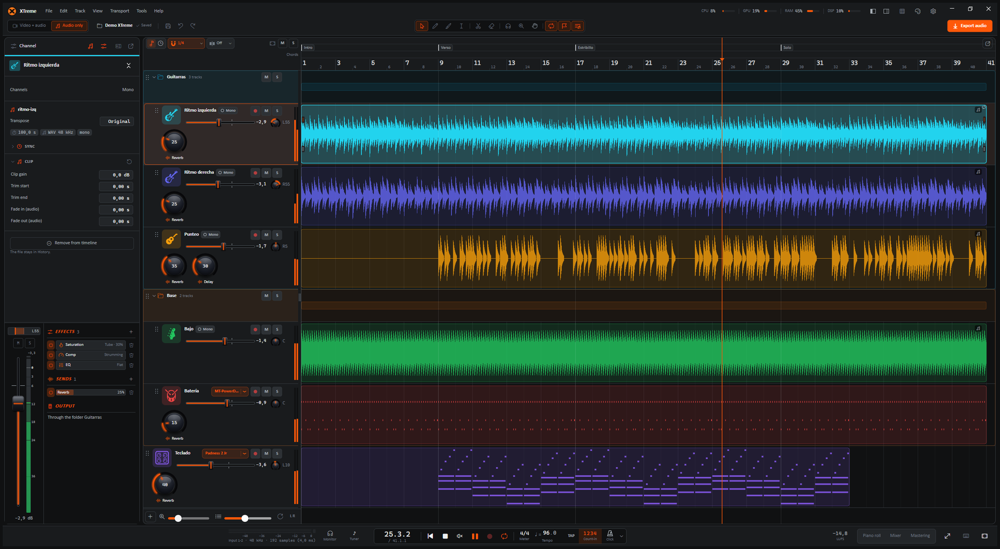
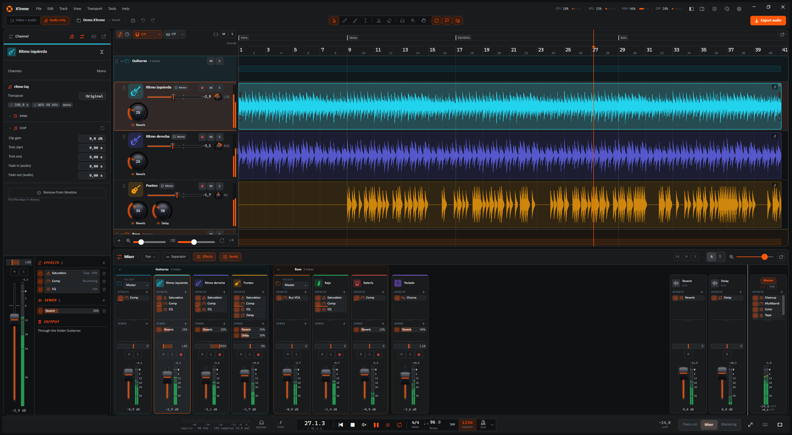
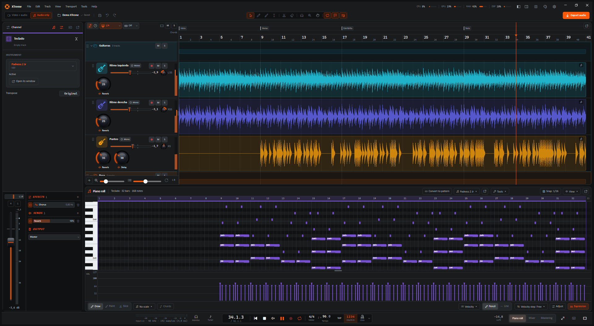

  

<h1 align="center">XTreme</h1>

  <b>Un DAW para grabar, mezclar, masterizar y exportar música en Windows.</b> 
  Audio y MIDI, instrumentos y efectos VST3, buses y mastering. Y si grabás con cámara, también el video.

  <b>Español</b> · <a href="README_EN.md">English</a>

  
   
  Trae todo lo que necesita, sin instalar .NET · <a href="https://github.com/xtrimdr/XTreme/releases">Todas las versiones</a>

**XTreme** es un DAW para cualquier instrumento y cualquier estilo: guitarra, bajo, voz, teclados, batería, una
banda entera o una producción armada en la compu. Grabás, editás, mezclás, masterizás y exportás con pistas de audio
y MIDI, piano roll, instrumentos y efectos VST3, buses y una cadena de master completa.

Además hace **videos**: si grabás con cámara, cada toma guarda su imagen y XTreme arma un video con un panel por
toma, con color y formatos para redes. Es un extra para cuando lo necesitás; sin cámara, funciona como cualquier DAW.

XTreme está **programado desde cero**: el motor de audio, los efectos, los instrumentos y la interfaz son propios.
Toma ideas de los mejores DAWs del mercado, pero no se basa en el código de ninguno.

<b>Antes de instalar</b>

- **FFmpeg** y **ffprobe** en el `PATH` o instalados con winget, para la cámara, el video y la exportación. Si no están, XTreme te avisa
  al abrir y lo instala con un clic (winget), o te lleva a la página para bajarlo.
- Una interfaz de audio con driver **ASIO**, para grabar.
- El instalador no está firmado: si Windows SmartScreen avisa, elegí **Más información → Ejecutar de todas formas**.

Más detalles en [Requisitos](DETALLES.md#requisitos).

*Las capturas son de un proyecto de demo.*

## Qué hace

### Grabar

- Audio por **ASIO** (entrada y salida en un mismo callback, con monitoreo). Cada toma se escribe a disco mientras
  ocurre, así que un corte no la pierde.
- Se graba desde donde esté el cabezal, para regrabar solo un pedazo, con **metrónomo** (compás, tempo, tap tempo,
  cuenta previa y seis sonidos de click) y **calibración de latencia** con cable o tocando.
- **MIDI** desde teclados y controladores: cada pista MIDI elige su entrada y su canal, toca en vivo por su
  instrumento y graba las notas en un clip.
- **Afinador** con notas en castellano, flechas que indican para dónde girar la clavija y sensibilidad ajustable.

### Editar

- **Timeline** con varias pistas: clips que se mueven, recortan, dividen y duplican, fades, ganancia por clip con su
  **curva de volumen**, rango de borrado, deshacer y rehacer ilimitados, e importación de casi cualquier audio o video (WAV, MP3, FLAC, OGG,
  M4A, AIFF). **Detectar tempo** en cualquier clip (clic derecho) y poner el proyecto a esos BPM.
- **Pistas MIDI** con **piano roll**: doble clic en su carril crea un clip y lo abre. Clic escribe una nota, arrastrar
  la mueve o la alarga, clic derecho la borra, y abajo va la velocidad de cada nota.
- **Detectar escala y acordes**: la escala de un clip, sus notas y sus acordes en un resumen, y los acordes en su propia franja del timeline si querés.
- **Extraer MIDI**: las notas de un clip de audio (acordes o melodía) pasan a una pista MIDI, con el clic derecho o
  arrastrando el clip a una pista MIDI (Basic Pitch de Spotify, en la CPU).
- **Separar en stems**: un clip de audio se separa en 2, 4 o 6 pistas (voz, batería, bajo, guitarra, piano y resto), con
  calidad Rápida, Alta o Máxima, desde el clic derecho (Demucs, en la placa de video o en la CPU).
- **Carpetas** que se pliegan y agrupan pistas; varias pistas se marcan con Ctrl+clic / Shift+clic y se mueven juntas.
  Cada pista tiene su **color** (24, en orden de arco iris), un **ícono de instrumento** (guitarras, bajo, batería,
  synths, cuerdas, vientos, percusión…), su propio alto y sus knobs de Saturación, Comp, Reverb, Delay y Tono en el
  encabezado (cuáles se ven, en Configuración → Apariencia).
- Un sonido que te gusta se guarda como **plantilla de pista** y vuelve desde Nueva pista → Plantilla.
- Arriba de la regla, un **rango A–B** para repetir un tramo y **marcadores** con nombre (Intro, Estribillo, Solo…)
  para saltar de una parte a otra. Zoom de un tiempo a toda la canción con atajos que se asignan en Configuración →
  Atajos de teclado.

### Instrumentos y efectos VST3

- Cada pista MIDI toca con un **instrumento VST3** (Surge XT, MT-PowerDrumKit…: clic derecho en la pista →
  Instrumento, o el botón del piano roll, que también abre la ventana del plugin) o, sin plugin, con un tono de prueba.
- **Efectos VST3** en los canales y los buses (amps, pedales, reverbs de terceros): "+ Efecto" → VST3, en cualquier
  orden junto con los propios; "Abrir" abre su ventana y lo que ajustes ahí queda en el proyecto.
- También abre plugins **VST2** y de **32 bits**: los encuentra solos y los marca en la lista.
- Cada plugin corre en su propio proceso: si se cuelga, se calla ese y el resto sigue sonando. Lo que un plugin
  atrasa se compensa en toda la mezcla, el click y las tomas que grabás encima (PDC), y la exportación pasa por los
  mismos plugins.

### Mezclar

- Cadena de efectos por canal, en el orden que quieras: saturación (**Vida**, válvula o cinta), **compresor** con
  presets por categoría (voces, guitarras, bajo, batería, percusión y más), **EQ de 7 bandas** con espectro en vivo, bandas dinámicas y vista grande y **puerta de ruido**, más paneo
  con plantillas, botón **MONO** para chequear la mezcla y **FX** para escucharla sin efectos.
- **Transponer** por pista (−24 a +24 semitonos) sin cambiar el largo: se calcula en segundo plano (unos 4 s por
  3 min) con un vocoder de fase de alta calidad, se ve el progreso sobre los clips y queda guardada en `cache/`.
- **Mixer** completo con **buses**: cada pista o carpeta elige su salida (el master o un bus) y manda a los buses
  con sus envíos (antes o después del fader); los buses salen al master. Un bus tiene volumen, paneo y efectos: sirve
  para una reverb, un delay o para procesar un grupo. Una carpeta también es un canal: efectos, paneo, fader, M y S (su solo deja sonar sus pistas). Las tiras se ordenan arrastrándolas
  (el timeline las sigue), van a la izquierda o a la derecha, y hay separadores con nombre para proyectos grandes.
- **A | B** en la barra del mixer: dos mezclas de las mismas tomas (canales, envíos y buses) para comparar mientras
  suena; la B arranca como copia de la A y el clic derecho copia una sobre la otra u olvida la otra.
- Audio de nivel profesional: arrancar, parar, saltar y arrastrar el cabezal llevan su fundido, sin clics ni cortes.

### Masterizar

- Vista **Mastering** con la cadena del master: Look, limpieza, multibanda, color, Cinta, Ancho, soft clip y
  limitador con true peak. **Sugerime** escucha la mezcla y propone ajustes.
- **Destino** de volumen (YouTube, Instagram, TikTok, Spotify, Apple Music): se escucha mientras mezclás y la
  exportación lo respeta. Medidor de **LUFS** en la barra de transporte.

### Exportar

- Audio en **WAV** de 24 bits o **MP3** de 320 kbps; si querés, además cada pista en su WAV (**stems**).
- **Solo el loop A–B** ("Tramo" en el diálogo) para sacar un pedazo del tema, con la reverb y el delay sonando hasta
  apagarse después de B.
- La mezcla usa todos los núcleos del procesador.

### Videos

- Con una cámara (DirectShow o DroidCam por IP), cada toma graba también su imagen, en sincronía con el audio.
- Un panel por pista con cover-fit, zoom, paneo y espejo; relaciones **16:9 / 9:16 / 1:1**, disposición lado a lado
  o apilada, y el diseño de ventana **Vertical** para trabajar en 9:16.
- Pestaña de **color** con 28 looks (Brujo, Cine, Moody, Fresco, Noche azul, Hielo, Soñado, HDR…), ajustes
  (exposición, contraste, Blancos, Negros, Sensación de luz…), efectos (Nitidez, Claridad, Resplandor, viñeta,
  grano, barras de cine) y plantillas. Lo que ves en la vista previa es lo que se exporta.
- Exporta **MP4** con presets para **Reels · TikTok**, **YouTube** e **Instagram** (1:1 y 4:5); en **Avanzado**, la
  resolución (720p a 4K) y el bitrate. El video se codifica con la **placa de video** (NVIDIA, AMD o Intel) si hay
  una; si falla, sigue con el procesador.
- **Marcas de duración por red** en la regla (clic derecho): dónde termina una historia, un post de X, un Reel o
  Short, un TikTok. Si el tema se pasa, la línea se pone ámbar.

### Y además

- **No pierde nada**: guardado atómico (después de cada edición, cada X minutos o a mano con Ctrl+S o el diskette, a
  elección en Configuración → Guardado y exportación; las tomas se guardan siempre), la pestaña **Historial** para
  volver atrás (cada paso de esta sesión con su nombre, a un clic, y versiones guardadas: solas, con nombre o la de
  cada exportación), recuperación de grabaciones interrumpidas y un gestor de proyectos con Papelera y **paquetes
  ZIP** para llevar un proyecto a otra compu o guardar un respaldo completo.
- Idiomas, tema, atajos de teclado y diseño de la ventana (Clásico o Vertical) configurables.

## Hacia dónde va

XTreme está **en desarrollo constante**. La idea es llevarla a un nivel que sirva tanto
para quien recién empieza y quiere hacer música rápido y sin complicaciones, como para profesionales que
quieren hacer música en serio.

Ya están las pistas MIDI con su piano roll, un sampler propio y los instrumentos y efectos VST3; lo próximo son
perillas propias para los parámetros de los plugins y más herramientas de estudio. Lo que está
planeado y lo que falta está en [PENDIENTES.md](PENDIENTES.md).

## Más información

[DETALLES.md](DETALLES.md): requisitos, cómo compilar, atajos de teclado, cómo está hecho y `xtlab`.

## Contribuir y licencia

XTreme es **gratis y sin fines de lucro**: se hace para la comunidad, para que cualquiera
pueda grabar y hacer música sin pagar un peso. Las contribuciones son bienvenidas y **todas pasan por la
aprobación del mantenedor**: abrí un issue o un Pull Request siguiendo [CONTRIBUTING.md](CONTRIBUTING.md).
Antes de tocar código, leé [AGENTS.md](AGENTS.md) (la guía del proyecto) y mirá [PENDIENTES.md](PENDIENTES.md)
para ver qué falta.

Se distribuye bajo la licencia [GPL-3.0](LICENSE): podés usarla, estudiarla, modificarla y compartirla
libremente, y las versiones modificadas que se distribuyan tienen que seguir siendo libres bajo la misma licencia.

## Firma del código

El instalador se arma en GitHub Actions a partir de este repositorio ([instalador.yml](.github/workflows/instalador.yml)),
nunca en la PC de nadie, así lo que bajás sale de este código. Firma gratuita de código por
[SignPath.io](https://about.signpath.io), certificado de [SignPath Foundation](https://signpath.org).

- Commits y revisión: [xtrimdr](https://github.com/xtrimdr) (todo cambio de otra persona pasa por su aprobación).
- Aprobación de cada firma: [xtrimdr](https://github.com/xtrimdr).

**Privacidad**: el programa no manda información a ningún otro sistema, salvo lo que pidas vos: busca si hay una
versión nueva consultando la última release en GitHub (se apaga en Acerca de) y se conecta a la cámara por red que
configures.

## Modelos de Separar en stems

Los modelos son de Meta (Demucs, https://github.com/facebookresearch/demucs). XTreme no los incluye ni los aloja: se bajan de su fuente original a tu PC cuando los instalás. Tienen sus propios términos y no están cubiertos por la licencia de XTreme. La app funciona sin ellos.
